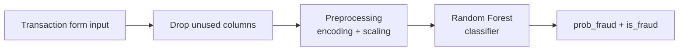

<div align="center">

# 💳 CredSecure

**Credit card fraud detection web app powered by a Random Forest classifier.**

[](https://credit-card-fraud-detection-1-41ac.onrender.com/)


[Live Demo](https://credit-card-fraud-detection-1-41ac.onrender.com/) · [Report Bug](../../issues)

</div>

---

## 📑 Table of Contents

1. [Overview](#-overview)
2. [Screenshots](#-screenshots)
3. [Features](#-features)
4. [Machine Learning Pipeline](#-machine-learning-pipeline)
5. [Model Performance](#-model-performance)
6. [Tech Stack](#-tech-stack)
7. [Project Structure](#-project-structure)
8. [Getting Started](#-getting-started)
9. [Roadmap](#-roadmap)
10. [Author](#-author)

---

## 📖 Overview

CredSecure classifies a credit card transaction as **normal or fraudulent**. A user enters the transaction details in a web form, and a trained Random Forest model returns a fraud verdict along with the fraud probability.

---

## 📸 Screenshots

| Home / Login | Detection Form |
|:---:|:---:|
|  |  |

| Fraud Result | Legitimate Result |
|:---:|:---:|
|  |  |

---

## ✨ Features

- **Real-time prediction:** submit a transaction and get a fraud / not-fraud verdict with a fraud probability score
- **Rich input:** merchant, category, amount, cardholder location, merchant location, city population and timestamp
- **User accounts:** signup, login and logout, with the About, Overview, Detection and Contact pages available after login
- **Cloud deployed** on Render with a Procfile and `render.yaml`

---

## 🤖 Machine Learning Pipeline



| Artifact | Purpose |
|---|---|
| `fraud_model_rf.joblib` | Trained Random Forest model |
| `preprocess.joblib` | Fitted preprocessing pipeline |
| `scaler.joblib` | Fitted feature scaler |
| `drop_cols.joblib` | Columns removed before prediction |
| `credit.ipynb` | Exploration, training and evaluation notebook |
| `model.py` | `predict_transaction()` used by the web app |

<!-- EDIT: dataset name/source, number of rows, fraud percentage -->
**Dataset:** _add dataset name, source link, number of transactions and fraud percentage._

**Class imbalance:** _describe how you handled it (SMOTE, class weights, undersampling, threshold tuning)._

---

## 📊 Model Performance

<!-- EDIT: fill from your notebook. Precision and recall matter more than accuracy for fraud. -->

| Metric | Score |
|---|---|
| Precision | _fill in_ |
| Recall | _fill in_ |
| F1-score | _fill in_ |
| ROC-AUC | _fill in_ |

> Fraud data is highly imbalanced, so accuracy alone is misleading. Precision, recall and F1 on the fraud class are the metrics that matter.

---

## 🧱 Tech Stack

| Layer | Technology |
|---|---|
| **Backend** | Python, Flask, Flask-SocketIO |
| **ML** | scikit-learn (Random Forest), Pandas, NumPy, joblib |
| **Frontend** | HTML, CSS, Jinja2 templates |
| **Notebook** | Jupyter |
| **Hosting** | Render (Procfile + `render.yaml`) |

---

## 📂 Project Structure

```
.
├── app.py                  # Flask app and routes
├── model.py                # Prediction logic
├── credit.ipynb            # Training and evaluation notebook
├── fraud_model_rf.joblib   # Trained model
├── preprocess.joblib       # Preprocessing pipeline
├── scaler.joblib           # Feature scaler
├── drop_cols.joblib        # Columns dropped before prediction
├── templates/              # HTML templates
├── static/                 # CSS, JS, images
├── requirements.txt
├── Procfile
└── render.yaml
```

---

## 🚀 Getting Started

**Prerequisites:** Python 3.10+

```bash
# 1. Clone
git clone https://github.com/MEHTHAB-N-M/credit_card_fraud_detection.git
cd credit_card_fraud_detection

# 2. Create a virtual environment
python -m venv venv
source venv/bin/activate        # Windows: .\venv\Scripts\activate

# 3. Install dependencies
pip install -r requirements.txt

# 4. Run
python app.py
```

Open **http://127.0.0.1:5000/**, sign up, then open the **Detection** page.

---

## 🗺️ Roadmap

- [ ] Replace CSV user storage with a database and hashed passwords
- [ ] Load the secret key from an environment variable
- [ ] Add a model performance dashboard
- [ ] Batch prediction via CSV upload
- [ ] REST API endpoint for predictions

---

## 👨‍💻 Author

**Mehthab N M**: Full-Stack & Python Developer

[Portfolio](https://mehthab-n-m.github.io/My_portfolio/) · [GitHub](https://github.com/MEHTHAB-N-M) · [LinkedIn](https://www.linkedin.com/in/mehthab-n-m-637611344)

---

<div align="center">⭐ If you like this project, consider giving it a star.</div>
